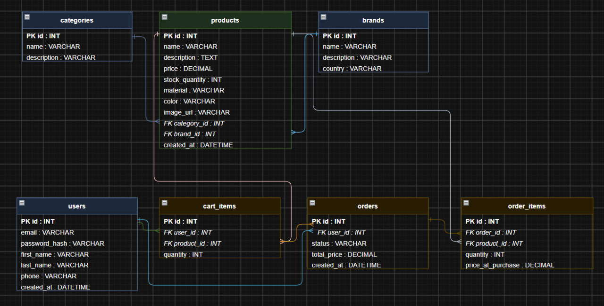

## Опис

**FurniGoga** - інтернет-магазин меблів та товарів для дому.

На сайті буде каталог з товарами, які можна буде відфільтрувати за категорією, брендом, матеріалом. Також буде сортування за ціною (за зростанням та спаданням) та популярністю. Авторизовані користувачі можуть додавати товари до кошика та оформлювати замовлення. У профілі доступна історія замовлень і редагування особистих даних. Також є сторінка «Про нас» з контактами та умовами доставки і повернення.

Дані передаються у форматі **JSON**. Базовий URL: `/api/v1`

---

## API Endpoints

### Товари

| Метод | Endpoint | Опис |
|---|---|---|
| `GET` | `/products` | Список товарів: `search`, `category_id`, `brand_id`, `material`, `min_price`, `max_price`, `sort` (`price_asc` / `price_desc` / `popularity`) |
| `GET` | `/products/{id}` | Детальна інформація про товар |
| `POST` | `/products` | Створити товар (адмін) |
| `PATCH` | `/products/{id}` | Оновити товар (адмін) |
| `DELETE` | `/products/{id}` | Видалити товар (адмін) |

<details>
<summary>Приклади запитів і відповідей</summary>

**GET /products - 200 OK**
```json
[
  { "id": 1, "name": "Диван OSLO", "price": 12999.00, "category": "Дивани", "brand": "Nordic Home", "image_url": "..." }
]
```

**GET /products/{id} - 200 OK**
```json
{ "id": 1, "name": "Диван OSLO", "description": "...", "price": 12999.00, "stock_quantity": 15, "material": "Тканина", "color": "Сірий", "category": { "id": 1, "name": "Дивани" }, "brand": { "id": 2, "name": "Nordic Home" } }
```

**POST /products - Request Body - 201 Created**
```json
{ "name": "Диван OSLO", "description": "...", "price": 12999.00, "stock_quantity": 15, "material": "Тканина", "color": "Сірий", "category_id": 1, "brand_id": 2 }
```

**PATCH /products/{id} - Request Body - 200 OK**
```json
{ "price": 11999.00 }
```

**DELETE /products/{id} - 204 No Content**

**Помилка - 404 Not Found**
```json
{ "error": "Товар не знайдено" }
```
</details>

---

### Категорії

| Метод | Endpoint | Опис |
|---|---|---|
| `GET` | `/categories` | Список усіх категорій |
| `GET` | `/categories/{id}` | Категорія та всі її товари |
| `POST` | `/categories` | Створити категорію (адмін) |
| `PATCH` | `/categories/{id}` | Оновити категорію (адмін) |
| `DELETE` | `/categories/{id}` | Видалити категорію (адмін) |

<details>
<summary>Приклади запитів і відповідей</summary>

**GET /categories - 200 OK**
```json
[{ "id": 1, "name": "Дивани", "description": "М'які меблі для вітальні" }]
```

**GET /categories/{id} - 200 OK**
```json
{ "id": 1, "name": "Дивани", "products": [{ "id": 1, "name": "Диван OSLO", "price": 12999.00 }] }
```

**POST /categories - Request Body - 201 Created**
```json
{ "name": "Ліжка", "description": "..." }
```
</details>

---

### Бренди

| Метод | Endpoint | Опис |
|---|---|---|
| `GET` | `/brands` | Список усіх брендів |
| `GET` | `/brands/{id}` | Бренд та всі його товари |
| `POST` | `/brands` | Створити бренд (адмін) |
| `PATCH` | `/brands/{id}` | Оновити бренд (адмін) |
| `DELETE` | `/brands/{id}` | Видалити бренд (адмін) |

<details>
<summary>Приклади запитів і відповідей</summary>

**GET /brands - 200 OK**
```json
[{ "id": 1, "name": "Nordic Home", "country": "Данія" }]
```

**GET /brands/{id} - 200 OK**
```json
{ "id": 1, "name": "Nordic Home", "country": "Данія", "products": [...] }
```

**POST /brands - Request Body - 201 Created**
```json
{ "name": "Urban Living", "country": "Швеція", "description": "..." }
```
</details>

---

### Кошик (тільки для авторизованих)

| Метод | Endpoint | Опис |
|---|---|---|
| `GET` | `/cart` | Вміст кошика поточного користувача |
| `POST` | `/cart/items` | Додати товар до кошика |
| `PATCH` | `/cart/items/{id}` | Змінити кількість товару |
| `DELETE` | `/cart/items/{id}` | Видалити товар з кошика |

<details>
<summary>Приклади запитів і відповідей</summary>

**GET /cart - 200 OK**
```json
{ "items": [{ "id": 1, "product": { "id": 1, "name": "Диван OSLO", "price": 12999.00 }, "quantity": 2 }], "total": 25998.00 }
```

**POST /cart/items - Request Body - 201 Created**
```json
{ "product_id": 1, "quantity": 2 }
```

**PATCH /cart/items/{id} - Request Body - 200 OK**
```json
{ "quantity": 3 }
```

**DELETE /cart/items/{id} - 204 No Content**
</details>

---

### Замовлення (тільки для авторизованих)

| Метод | Endpoint | Опис |
|---|---|---|
| `GET` | `/orders` | Список замовлень поточного користувача |
| `POST` | `/orders` | Створити замовлення з кошика (кошик очищується) |
| `GET` | `/orders/{id}` | Деталі конкретного замовлення |

<details>
<summary>Приклади запитів і відповідей</summary>

**GET /orders - 200 OK**
```json
[{ "id": 1, "status": "processing", "total_price": 25998.00, "created_at": "2026-10-13T18:00:00Z" }]
```

**POST /orders - Request Body не потрібне - 201 Created**
```json
{ "id": 1, "status": "processing", "total_price": 25998.00, "items": [...], "created_at": "2026-10-13T18:00:00Z" }
```

**Кошик порожній - 400 Bad Request**
```json
{ "error": "Кошик порожній" }
```
</details>

---

### Авторизація та профіль 
*TODO: авторизація буде реалізована пізніше*

| Метод | Endpoint | Опис |
|---|---|---|
| `POST` | `/auth/register` | Реєстрація |
| `POST` | `/auth/login` | Вхід |
| `POST` | `/auth/logout` | Вихід |
| `GET` | `/users/me` | Профіль поточного користувача |
| `PATCH` | `/users/me` | Оновити профіль |

<details>
<summary>Приклади запитів і відповідей</summary>

**POST /auth/register - Request Body - 201 Created**
```json
{ "email": "user@example.com", "password": "...", "first_name": "Іван", "last_name": "Петренко" }
```

**POST /auth/login - Request Body - 200 OK**
```json
{ "email": "user@example.com", "password": "..." }
```

**GET /users/me - 200 OK**
```json
{ "id": 1, "email": "user@example.com", "first_name": "Іван", "last_name": "Петренко", "phone": "+380501234567" }
```

**PATCH /users/me - Request Body - 200 OK**
```json
{ "phone": "+380501234567" }
```
</details>

---

### Про нас

| Метод | Endpoint | Опис |
|---|---|---|
| `GET` | `/about` | Контакти, умови доставки та повернення |

<details>
<summary>Приклад відповіді</summary>

**GET /about - 200 OK**
```json
{ "description": "FurniGoga — інтернет-магазин меблів...", "contacts": { "email": "info@furnigoga.ua", "phone": "+380000000000" }, "delivery_info": "...", "return_policy": "..." }
```
</details>

---

## Схема бази даних

